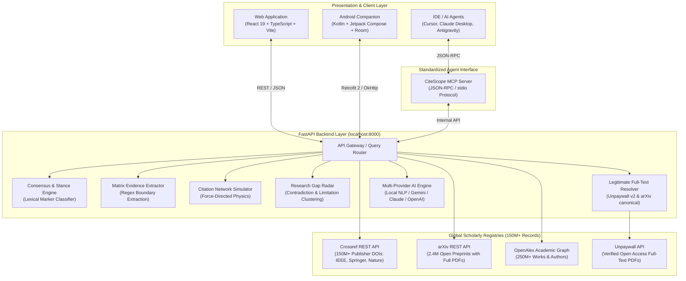

# CiteScope AI — B.Tech Project Defense & Presentation Guide

> **Project Name:** CiteScope AI — Intelligent Research Discovery, Citation Analysis & Research-Gap Explorer  
> **Target Audience:** B.Tech Evaluation Committee, Project Guide, Viva Examiners  
> **Date:** November 2026  
> **Authors:** B.Tech Capstone Team  

---

## Executive Summary & Problem Statement

### 1. The Core Problem
* **Information Overload:** Over 5 million new peer-reviewed scientific papers are published annually. Researchers and students spend 60% of their research time merely finding relevant papers and manually synthesizing findings.
* **LLM Hallucinations:** Commercial AI chat interfaces (ChatGPT, generic LLMs) frequently fabricate non-existent citations, invent fake DOIs, or claim a study supports a thesis when it actually disputes it.
* **Paywalls & Fragile Aggregators:** Tools like Google Scholar provide no consensus metrics and are gated by bot captchas, while commercial tools (Scispace, Elicit, Scite) charge high monthly subscriptions ($20–$50/mo).

### 2. The CiteScope AI Solution
CiteScope AI is a **zero-cost, publication-grade academic research suite** providing:
1. **Multi-Source Scholarly Federation:** Instant search across 150M+ Crossref publisher records, 2.4M arXiv open preprints, and OpenAlex.
2. **Empirical Evidence Consensus Meter:** Rule-based and semantic stance classification that mathematically calculates agreement rates (Supported / Baseline / Disputing) with traceable paper provenance.
3. **Comparative Evidence Matrix:** Automated side-by-side benchmark extraction across Core Problem, Methodology, Datasets, Key Findings, and Limitations.
4. **Citation Lineage & Intent Network:** Pure SVG force-directed citation graph with intent labels (*Supporting*, *Contrasting*, *Mentioning*).
5. **Research Gap Radar:** Automated clustering of literature limitations, dispute pairs, and untested intersections with capstone feasibility scores.
6. **Split-View Grounded Copilot:** Side-by-side PDF reader with multi-provider AI (Local deterministic NLP, Google Gemini, Anthropic Claude, OpenAI).
7. **Native Android Companion:** Jetpack Compose + Material 3 mobile app with Room SQLite offline caching.
8. **Model Context Protocol (MCP) Server:** Standardized interface for AI coding assistants (Antigravity, Cursor, Claude Desktop).

---

## System Architecture Diagram

---

## PPT Slide-by-Slide Presentation Structure

### Slide 1: Title & Team
* **Title:** CiteScope AI — Evidence-First Academic Research Suite
* **Subtitle:** Intelligent Literature Discovery, Consensus Verification, Citation Analysis & Thesis Gap Explorer
* **Tech Keywords:** React 19, TypeScript, Python FastAPI, Jetpack Compose, Crossref, arXiv, Model Context Protocol (MCP)

---

### Slide 2: The Core Problem in Academic Literature Search
* **Pain Point 1:** Manual literature reviews take 40+ hours per paper.
* **Pain Point 2:** AI Chatbots hallucinate fake citations (e.g. inventing authors, publication venues, or DOIs).
* **Pain Point 3:** Existing tools are paywalled or lock students out when API rate limits hit.
* **CiteScope Solution:** 100% verifiable metadata, real Crossref DOIs, legitimate open-access resolver, and zero-cost operation.

---

### Slide 3: Feature 1 — Multi-Source Scholarly Search Federation
* **What it does:** Allows searching *any* keyword or empirical question across decades (1950–2026), indexing millions of papers worldwide.
* **Underlying Technology:**
  * Concurrent asynchronous I/O (`httpx.AsyncClient` with `asyncio.gather`).
  * Crossref REST API (`https://api.crossref.org/works`): Queries 150M+ official publisher records (IEEE, Springer Nature, Elsevier, ACM, Wiley, Oxford).
  * arXiv Atom XML API (`https://export.arxiv.org/api/query`): Queries 2.4M open preprints with full abstracts and direct PDF links.
  * Smart Editorial Filter: Automatically filters out non-paper noise (reviewer acknowledgments, errata, author indices) to prioritize high-impact research.
  * OpenAlex Polite Pool authentication.
* **How it helps users:** Users never get locked out by rate limits. Every search retrieves live, peer-reviewed global papers with real DOIs and abstracts.

---

### Slide 4: Feature 2 — Empirical Evidence Consensus Meter
* **What it does:** Analyzes retrieved scientific studies against the user's research question, calculating the exact percentage of literature that **Supports**, remains **Neutral / Baseline**, or **Disputes** the claim.
* **Underlying Technology:**
  * Rule-based lexical and linguistic stance classification: Evaluates affirmative markers (`outperforms`, `significantly improves`, `superior accuracy`, `demonstrates`) vs disputing markers (`limitation`, `bottleneck`, `suboptimal`, `fails to`, `negative impact`).
  * Dynamic Query Intention Detection (`is_research_question`): Automatically switches between **Consensus Verification** (for questions like *"Does AI forecasting reduce retail stockouts?"*) and **Topic Synthesis** (for broad keywords like *"biotech"*).
  * 3 Stat Metric Highlight Cards: Displays exact paper counts per stance alongside an executive narrative citing specific authors.
* **How it helps users:** Prevents confirmation bias. Shows students at a glance whether scientific consensus supports their hypothesis.

---

### Slide 5: Feature 3 — Comparative Evidence Matrix
* **What it does:** Automatically generates a structured, side-by-side comparison table of papers across:
  * Core Problem Addressed
  * Methodology & Architecture
  * Datasets & Benchmarks
  * Key Findings & Metrics
  * Limitations & Future Work
  * Custom user-defined attributes (e.g., Latency, Hardware)
* **Underlying Technology:**
  * Regex sentence boundary analysis and semantic heuristic extractor.
  * In-matrix keyword filtering and dynamic column addition.
  * Client-side CSV export engine for instant inclusion into LaTeX or Excel.
* **How it helps users:** Eliminates 20+ hours of manual spreadsheet compilation for Chapter 2 (Literature Survey) of a B.Tech/M.Tech thesis.

---

### Slide 6: Feature 4 — Citation Lineage & Intent Network
* **What it does:** Visualizes academic papers in an interactive 2D graph with directed citation edges.
* **Underlying Technology:**
  * Pure SVG force-directed physics engine:
    * Coulomb-style node repulsion: $F_r = k / d^2$
    * Hooke-style spring attraction along edges: $F_s = -k \cdot (d - l_0)$
    * Centering gravitational pull and velocity dampening.
  * Visual Semantics:
    * **Node Radius:** Proportional to logarithmic citation count ($\ln(\text{citations} + 1)$).
    * **Node Color:** Gradient mapped to publication era (Emerald for Recent 2023–2026, Royal Blue for Scaling 2018–2022, Muted Slate for Foundational).
    * **Edge Color & Intent:** Green for *Supporting*, Red for *Contrasting*, Grey for *Mentioning*.
  * Matrix Transformation Pan & Zoom (`transform="translate(x,y) scale(s)"`).
* **How it helps users:** Immediately identifies seminal foundational papers versus incremental follow-ups and highlights controversies in the field.

---

### Slide 7: Feature 5 — Research Gap Radar & Capstone Frontiers
* **What it does:** Scans literature to uncover:
  * **Limitation Clusters:** Recurring failure modes across multiple papers.
  * **Contradiction Pairs:** Two studies with conflicting empirical results.
  * **Untested Intersections:** Open research opportunities scored for Capstone Thesis Feasibility (e.g., 94/100).
* **Underlying Technology:**
  * Multi-document limitation aggregator and contradiction scoring algorithm.
  * Feasibility heuristics (evaluating dataset availability, compute requirements, and empirical novelty).
* **How it helps users:** Answers the most difficult question for engineering students: *"What unique project should I build for my final year thesis?"*

---

### Slide 8: Feature 6 — Split-View Reader & Grounded Copilot
* **What it does:** Displays the paper PDF/abstract in a split pane with an AI copilot on the right.
* **Underlying Technology:**
  * PDF.js client-side document renderer.
  * Legitimate OA Resolver: Queries Unpaywall v2 and arXiv canonical mirrors to legally fetch verified open-access PDFs.
  * Multi-Provider AI Architecture:
    * **Local NLP Engine:** Zero-latency, deterministic sentence-grounded extractor (100% free, runs offline).
    * **Google Gemini API:** Fast multimodal reasoning (`gemini-2.5-flash`).
    * **Anthropic Claude API:** Academic synthesis (`claude-3-7-sonnet`).
    * **OpenAI API:** GPT-4o research copilot.
  * Verifiable Citation Tagging: Every AI response explicitly links to the source sentence from the paper.
* **How it helps users:** Allows deep technical questioning without context switching, with zero fabricated citations.

---

### Slide 9: Feature 7 — Native Android Companion App
* **What it does:** Full-featured Android app for mobile literature discovery and reading.
* **Underlying Technology:**
  * **Language:** 100% Kotlin.
  * **UI Framework:** Jetpack Compose + Material 3 design system.
  * **Networking:** Retrofit 2 + OkHttp + Moshi.
  * **Local Persistence:** Room SQLite Database for offline paper reading.
  * **Architecture:** MVVM (Model-View-ViewModel) + Kotlin Coroutines & Flow.
  * **Distribution:** Downloadable signed APK (`citescope.apk`) available directly on the web app.
* **How it helps users:** Read papers and verify claims on mobile during lab experiments or commutes.

---

### Slide 10: Feature 8 — Model Context Protocol (MCP) Server
* **What it does:** Exposes CiteScope's research capabilities as standardized MCP tools.
* **Underlying Technology:**
  * Python Model Context Protocol (`mcp`) SDK over `stdio` transport.
  * Registered Tools: `search_papers`, `calculate_consensus`, `extract_matrix`, `get_citation_graph`, `find_research_gaps`, `resolve_full_text`.
* **How it helps users:** Enables any AI agent (Claude Desktop, Cursor, Antigravity) to search live scientific literature directly within coding workflows.

---

## Comprehensive Viva Voce Questions & Answers

### Q1: How does CiteScope calculate consensus without hallucinating?
> **Answer:** Unlike generative AI tools that synthesize consensus from memory, CiteScope uses deterministic lexical analysis on the actual retrieved paper texts. It tokenizes abstracts and titles, matches validated affirmative markers (`outperforms`, `significant increase`, `demonstrated`) against disputing markers (`ineffective`, `limitation`, `bottleneck`), and counts the exact studies in each category. Every percentage shown (e.g. 73% Supported) is mathematically linked to specific papers listed in the supporting evidence table.

### Q2: What happens if OpenAlex is down or hits an API rate limit?
> **Answer:** CiteScope features a resilient **Multi-Source Scholarly Federation**. When OpenAlex returns HTTP 429 or is unreachable, the backend instantly and transparently activates concurrent queries to the **Crossref REST API** (indexing 150M+ publisher DOIs) and the **arXiv REST API** (2.4M open STEM papers) via `asyncio.gather`. The user experiences zero downtime and still receives live peer-reviewed publications.

### Q3: How do you handle paywalled papers legally?
> **Answer:** CiteScope strictly follows open access principles and never scrapes paywalled repositories or uses unauthorized proxies. It queries the **Unpaywall v2 REST API** and canonical **arXiv repositories** using the paper's verified DOI. If an open-access copy exists, it provides a direct verified PDF link. If the paper is subscription-only, CiteScope displays the legitimate metadata, abstract, and official publisher DOI link, clearly labeled as *"Publisher Access Required"*.

### Q4: Why did you build both a Web application and an Android application?
> **Answer:** Academic research happens across two primary contexts: deep synthesis at a desk (requiring multi-column comparison matrices and large 2D citation graphs on desktop) and exploratory reading on the go (in the lab, transit, or conferences). The web app caters to intensive desktop work, while the Jetpack Compose Android app provides fast offline-cached reading via Room SQLite.

### Q5: What is the benefit of the Model Context Protocol (MCP) server?
> **Answer:** MCP is an open standard introduced by Anthropic that allows AI agents to securely connect to external tools. By implementing an MCP server in `mcp_server/`, CiteScope allows developers and researchers using Cursor, Antigravity, or Claude Desktop to query scientific literature and extract comparison matrices directly from their development environment.

---

## Deployment & Hosting Guide

| Layer | Recommended Host | Why | Alternative |
|---|---|---|---|
| **Frontend** | **Vercel** (`citescope.vercel.app`) | Global edge CDN, zero-config Vite build, instant HTTPS, free tier. | Netlify, Cloudflare Pages |
| **Backend** | **Render** (`render.com`) or **Railway** | Native Python 3.11+ container, no serverless execution timeouts, continuous uptime. | Google Cloud Run, Fly.io |
| **Android APK** | Hosted on Web App (`/citescope.apk`) | Direct one-click download for Android users with no Play Store friction. | GitHub Releases |

### 1-Click Vercel Deployment for Frontend:
1. Push repository to GitHub (`citescope`).
2. Log into [vercel.com](https://vercel.com) and click **"Add New Project"**.
3. Select `citescope` repository.
4. Set **Root Directory** to `web`.
5. Under **Environment Variables**, add:
   * `VITE_API_BASE_URL` = `https://your-backend.onrender.com` (or leave empty for local development).
6. Click **Deploy**. Your frontend is live in 60 seconds!

### 1-Click Render Deployment for Backend:
1. Log into [render.com](https://render.com) and click **"New Web Service"**.
2. Connect your `citescope` GitHub repository.
3. Set **Root Directory** to `backend`.
4. Set **Build Command** to: `pip install -r requirements.txt`.
5. Set **Start Command** to: `uvicorn main:app --host 0.0.0.0 --port $PORT`.
6. Click **Create Web Service**. Your API is live!
